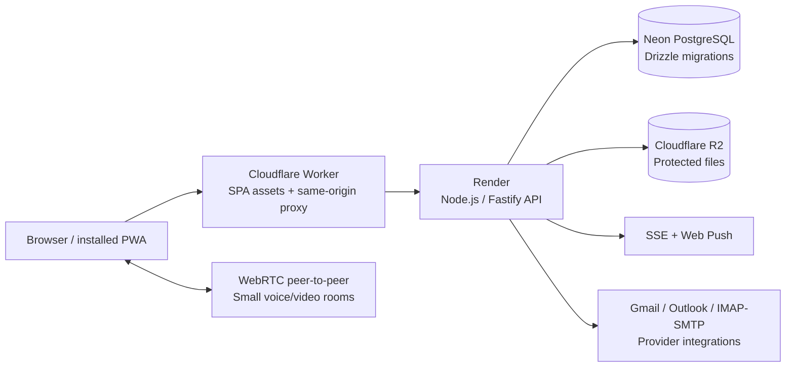

# Uorqui — engineering portfolio case study

[English](portfolio.md) · [Português](../pt-BR/portfolio.md) · [Back to README](../../README.md) · [Live beta](https://uorqui.app)

**Project type:** original open-source communication PWA · **Status:** technical beta `0.1.0-beta.39` · **Repository:** [gabrielduclos/uorqui](https://github.com/gabrielduclos/uorqui) · **License:** MIT

## The challenge

Private chats, communities, voice calls and mail are often spread across different interfaces. The product hypothesis is that a connected workflow — **discover a community → communicate in its channels → message someone directly → organize related communications** — can reduce context switching. This is an hypothesis **to validate**, not a proven business result.

Uorqui is intentionally not a Discord clone or another endless social feed. The team decided to retire an earlier global feed and make Discover an entry point into communities. The product supports a general audience, with gaming communities as an initial testing segment.

## Scope and role

This is a self-directed product/engineering learning project led by the repository owner, covering feature specification, UX decisions, architecture selection, integration, testing and deployment. **AI-assisted tools are used** for code creation and refinement, debugging and documentation; the case study does not claim that every implementation detail was handwritten or mastered without assistance. The repository, tests and history provide inspectable evidence of how the system is evolving.

This case study demonstrates the ability to translate requirements into an integrated working system and reason about trade-offs. It does **not** claim professional production scale, independent penetration testing or an externally audited codebase.

## System architecture

The API is a **modular monolith**. It exposes bounded domains for auth/profiles, private messaging, communities, invitations, meetings, notifications and email. UI and API are deployed separately, while first-party cookies and API calls share the `uorqui.app` web origin through an edge proxy.

## Engineering decisions and trade-offs

| Problem | Implemented approach | Trade-off / next verification |
| --- | --- | --- |
| Fast, consistent conversations | Persist messages in PostgreSQL, emit authenticated **SSE** updates and use optimistic client state | Reconnect, deduplication and multi-device behavior need device/load testing |
| Scoping community content | Server-side membership and channel permissions; single-use, hashed channel invites | Test all permission combinations and revocation paths on physical devices |
| Keeping meeting access distinct | A **reusable link** identifies a meeting for already authorized members; granting channel access requires a separate invitation | Avoids accidentally granting community access through a meeting URL |
| Constraining live meeting cost | WebRTC mesh for **up to six**, server-backed **60-minute deadline** and client countdown | Mesh overhead grows with participants; TURN and cross-network behavior remain to validate |
| Keeping media off the SQL database | Store media in **R2**, metadata and access relationships in PostgreSQL | Storage quotas, cleanup jobs and upload lifecycle need monitoring |
| Authenticating across two hosts | **Better Auth** sessions and a same-origin Cloudflare proxy; signed visitor-IP proof for the API | Shared NAT addresses still exist; avoid assuming an IP identifies one user |
| Handling HTTP 429 incidents | Request coalescing, short in-tab cache for account lookups, backoff and **origin diagnostics** | The original cause is not proven; Render Free inbound throttling is a plausible cause, not a conclusion |
| Avoiding unnecessary platform features | Retired the global feed and moved to **Discover** with authorized community activity | Product-market fit still requires actual user interviews and retention measurement |

### A real operational debugging example: HTTP 429

The beta experienced HTTP 429 with a small test audience. Investigation found that some users shared a public IP, while startup could duplicate account-probe requests. A global **Cloudflare 120 requests/10 s per-IP** rule was introduced **after** the first reports, then **disabled November 10, 2026**; it was not the original cause. Backend sign-in and authentication safeguards remain active.

The code now includes request deduplication for `/api/v1/me`, sanitized browser-side diagnostics (`window.__uorquiRateLimitDiagnostics()` and `window.__uorquiAuthDiagnostics()`), and explicit upstream markers. **No definitive root cause has been established** from the observed logs. The correct lesson is to measure each layer before increasing limits.

Evidence: [web tests](../../apps/web/test), [API tests](../../apps/api/test), [Cloudflare rate-limit incident note](cloudflare-rate-limiting.md), [beta.35–36 changelog](../../CHANGELOG.md).

## Evidence you can inspect

- **Frontend:** [apps/web/src](../../apps/web/src), the [Cloudflare proxy](../../apps/web/worker/index.ts), [component tests](../../apps/web/test) and [UI kit](ui-kit.md).
- **API:** [apps/api/src](../../apps/api/src), [Better Auth integration](../../apps/api/src/auth/auth.ts), [community routes](../../apps/api/src/community-routes.ts) and [live messaging events](../../apps/api/src/dm-events.ts).
- **Data:** [Drizzle schema](../../apps/api/src/db/schema.ts) and [versioned SQL migrations](../../apps/api/drizzle).
- **Quality:** [GitHub workflows](../../.github/workflows), [API integration tests](../../apps/api/test), [release policy](versions.md), [bilingual changelogs](../../CHANGELOG.md).
- **Product decisions:** [Discover direction](discover.md), [community permissions](channel-permissions.md), [meeting rules](video-meetings.md), [roadmap](roadmap.md).

These are navigational links to real files, not performance or security certifications.

## Current validation status

**Implemented and testable:** registration/session flows under configured environments, persisted 1:1 messaging, communities, roles, invited access, voice/meeting channels, email-provider integration paths, notification preferences, R2 attachments, migrations and CI.

**Not yet independently validated for broad release:** end-to-end mail onboarding with live providers, all iOS/Android PWA and Web Push scenarios, TURN relay / cross-network calls, realistic concurrency, security review, accessibility audit and operating costs.

There are no published production-scale throughput, uptime, adoption or business-impact metrics. Do not infer them from feature count or passing CI. Demo accounts, screenshots and a short video walkthrough would improve recruiter evaluation; these materials have **not** been added yet.

## Next improvements

1. Record a short **demo** showing onboarding, messaging, community channels and meeting admission without exposing user data.
2. Run a documented device matrix (iOS Safari/PWA, Android Chrome/PWA, desktop) and two-network WebRTC tests.
3. Add repeatable **load tests**, 429 origin dashboards, media cleanup verification and realistic cost measurements.
4. Report measurable product feedback before claiming a validated market need.

**Suggested review order:** [README](../../README.md) → this case study → [architecture](architecture.md) → [tests](../../apps/api/test) → [changelog](../../CHANGELOG.md). The running beta is available at [uorqui.app](https://uorqui.app), subject to beta availability.
