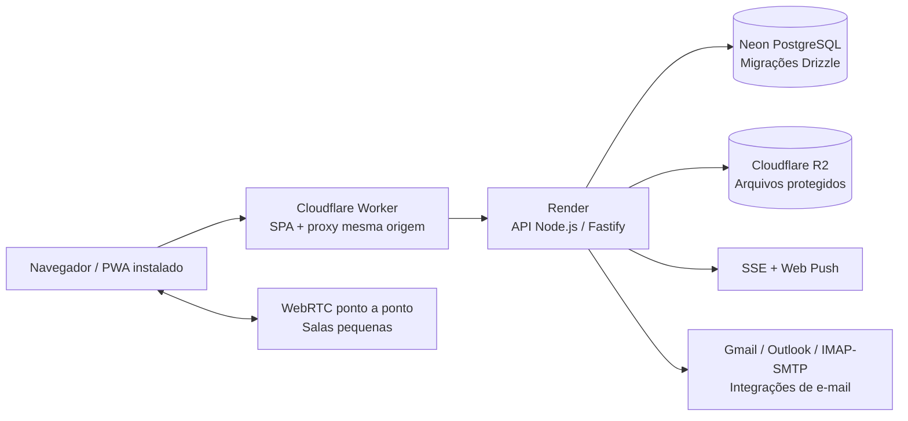

# Uorqui — estudo de caso de engenharia para portfólio

[Português](portfolio.md) · [English](../en/portfolio.md) · [Voltar ao README](../../README.pt-BR.md) · [Beta ao vivo](https://uorqui.app)

**Tipo:** PWA original de comunicação e código aberto · **Situação:** beta técnico `0.1.0-beta.40` · **Repositório:** [gabrielduclos/uorqui](https://github.com/gabrielduclos/uorqui) · **Licença:** MIT

## O desafio

Mensagens privadas, comunidades, chamadas e e-mails ficam frequentemente espalhados por diferentes ferramentas. A hipótese do produto é que o fluxo **descobrir uma comunidade → participar dos canais → falar diretamente com alguém → organizar comunicações relacionadas** pode diminuir a troca de contexto. Essa é uma **hipótese em validação**, não um resultado comercial comprovado.

O Uorqui não busca ser uma cópia do Discord nem mais um feed infinito. Um feed global que existia no projeto foi descontinuado e substituído pelo Descobrir, voltado a comunidades. O produto é de uso geral; comunidades gamers servem como público inicial de experimentação.

## Escopo e atuação

Projeto independente de aprendizado em produto e engenharia, conduzido pelo responsável pelo repositório. Envolve definição de funcionalidades, decisões de UX, escolhas de arquitetura, integração, testes e publicação. **Ferramentas de IA apoiam** a criação e revisão de código, a depuração e a documentação; não se afirma que cada detalhe foi programado manualmente ou dominado sem assistência. O repositório, os testes e o histórico permitem analisar a evolução do sistema.

O estudo demonstra a capacidade de transformar requisitos em um sistema integrado e discutir escolhas técnicas. **Não** é uma alegação de escala profissional, pentest independente ou código auditado externamente.

## Arquitetura do sistema

A API utiliza **monólito modular**, com domínios para autenticação/perfis, mensagens privadas, comunidades, convites, reuniões, notificações e e-mail. Interface e API são publicadas separadamente, mas as requisições e os cookies de sessão usam a origem `uorqui.app` por meio de um proxy na borda.

## Decisões técnicas e compromissos

| Problema | Solução implementada | Limite / próxima validação |
| --- | --- | --- |
| Conversas responsivas | Mensagens em PostgreSQL, eventos autenticados por **SSE** e estado otimista na interface | Reconexão, duplicidades e múltiplos dispositivos exigem testes adicionais |
| Privacidade nos canais | Associação e permissões verificadas no servidor; convite de canal com token de uso único e hash | Testar combinações de permissões e revogação em aparelhos reais |
| Acesso à reunião independente | **Link reutilizável** aponta a reunião para usuários já autorizados; acesso ao canal é concedido por convite diferente | Impede que compartilhar a reunião conceda acesso à comunidade |
| Custo de reuniões | WebRTC em malha para **até seis pessoas**, **limite de 60 minutos** aplicado pelo servidor e cronômetro no cliente | Custo da malha cresce com participantes; testar TURN e redes distintas |
| Separação de dados e arquivos | Mídias no **R2** e metadados/permissões no PostgreSQL | Monitorar armazenamento, limpeza e ciclo de uploads |
| Sessões entre plataformas | **Better Auth**, proxy Cloudflare na mesma origem e prova assinada do IP do visitante | IP público compartilhado não corresponde a um único usuário |
| Incidentes HTTP 429 | Deduplicação de consultas de conta, cache curto por aba, backoff e **diagnóstico de origem** | Causa inicial não comprovada; limite de entrada do Render Free é hipótese plausível |
| Escopo de produto | Remoção do feed global e adoção do **Descobrir** com atividade autorizada | Valor do produto depende de entrevistas e retenção reais |

### Exemplo real de diagnóstico: HTTP 429

O beta apresentou HTTP 429 com uma base pequena de testes. Havia usuários compartilhando IP público, enquanto a inicialização podia repetir consultas de conta. Uma regra global da **Cloudflare de 120 requisições/10 s por IP** foi criada **depois** dos primeiros relatos e **desativada em 10/11/2026**; ela não causou o primeiro problema. As proteções de autenticação do backend continuam ativas.

O código agora deduplica chamadas de `/api/v1/me` e disponibiliza diagnósticos sem identificadores pessoais (`window.__uorquiRateLimitDiagnostics()` e `window.__uorquiAuthDiagnostics()`), além de marcar erros repassados pela API. **Os logs vistos não comprovam a causa raiz.** O aprendizado é medir as camadas antes de aumentar limites.

Evidências: [testes do frontend](../../apps/web/test), [testes da API](../../apps/api/test), [registro da Cloudflare](cloudflare-rate-limiting.md), [changelog beta.35–36](../../CHANGELOG.pt-BR.md).

## Evidências verificáveis

- **Frontend:** [apps/web/src](../../apps/web/src), [proxy Cloudflare](../../apps/web/worker/index.ts), [testes de componentes](../../apps/web/test), [UI kit](ui-kit.md).
- **API:** [apps/api/src](../../apps/api/src), [Better Auth](../../apps/api/src/auth/auth.ts), [rotas de comunidade](../../apps/api/src/community-routes.ts), [eventos de mensagem](../../apps/api/src/dm-events.ts).
- **Dados:** [schema Drizzle](../../apps/api/src/db/schema.ts) e [migrações SQL versionadas](../../apps/api/drizzle).
- **Qualidade:** [workflows do GitHub](../../.github/workflows), [testes de integração](../../apps/api/test), [política de versões](../pt-BR/versoes.md), [histórico em português](../../CHANGELOG.pt-BR.md).
- **Produto:** [decisão do Descobrir](descobrir.md), [permissões de canais](permissoes-canais.md), [regras de reuniões](reunioes-video.md), [roadmap](roadmap.md).

São referências a arquivos reais, **não certificações de desempenho ou segurança**.

## Validação atual

**Implementado e passível de teste:** cadastro/sessão sob ambiente configurado, mensagens 1:1 persistidas, comunidades, papéis, convites, salas de voz/reunião, integração com provedores de e-mail, preferências de notificação, arquivos no R2, migrações e CI.

**Ainda não validado de forma independente para lançamento amplo:** cadastro e envio real por todos os provedores, todas as combinações de PWA iOS/Android e Web Push, TURN e chamadas entre redes, concorrência realista, revisão de segurança, auditoria de acessibilidade e custos operacionais.

Não existem métricas publicadas de escala, disponibilidade, adoção ou impacto comercial. Não se deve inferir isso do volume de recursos nem de testes de CI. Contas de demonstração, capturas e vídeo curto facilitariam a avaliação por recrutadores; **esses materiais ainda não foram incluídos**.

## Próximos passos

1. Gravar **demonstração curta** de cadastro, mensagens, canais e aprovação de reuniões, sem exibir dados de usuários.
2. Documentar matriz de aparelhos (Safari/PWA iOS, Chrome/PWA Android, desktop) e chamadas WebRTC entre redes.
3. Criar **testes de carga** repetíveis, diagnóstico da origem do 429, verificação da limpeza de arquivos e custo estimado.
4. Registrar feedback real antes de afirmar que a necessidade de mercado foi comprovada.

**Roteiro para avaliação:** [README](../../README.pt-BR.md) → este estudo de caso → [arquitetura](arquitetura.md) → [testes](../../apps/api/test) → [notas de versão](../../CHANGELOG.pt-BR.md). O beta está em [uorqui.app](https://uorqui.app), sujeito a disponibilidade.
